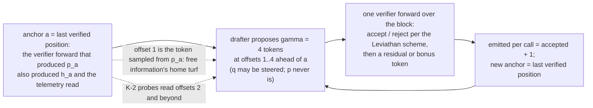
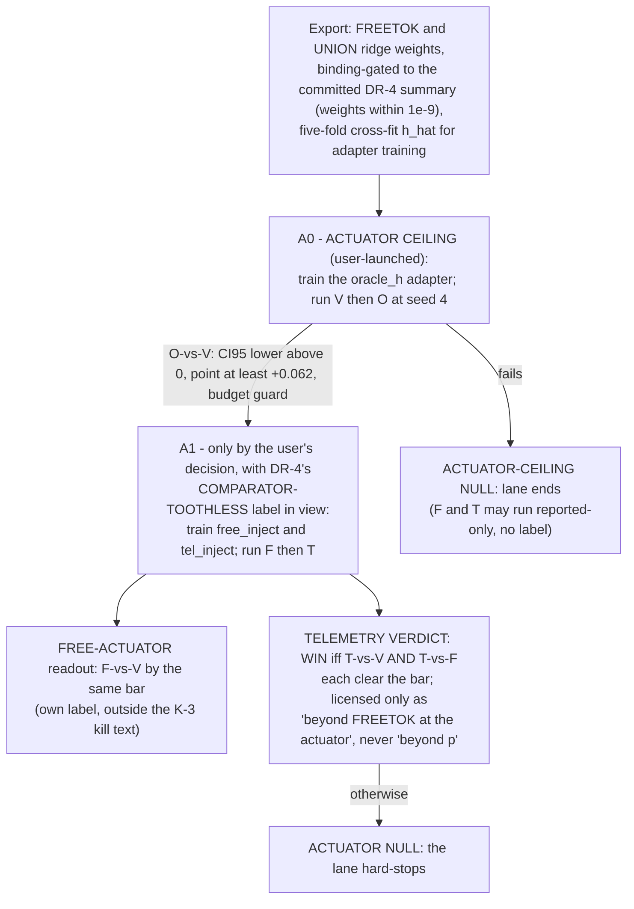

# Sideband: can a memory device's address stream steer a speculative-decoding drafter? A technical report

- Repository: `https://github.com/Mike-Byrne-AI/specdec-sidechannels`, folder sideband/ (HEAD 8542ef5 = the STAGE-A FREEZE commit 2e44105 plus the release-hygiene code commit; package version 0.3.0 per `pyproject.toml`)
- Report date: 2026-09-05
- License: MIT (LICENSE at the root of the specdec-sidechannels repository; chosen 2026-10-12)
- Audience: research scientists in speculative decoding, interpretability, and memory systems
- Status language used throughout is the repository's own: **shown** (registered gate passed and replicated or critic-recomputed), **not shown** (registered gate failed or never run), **unpriced** (measured but not separable from a confound), **qualified** (passed with a disclosed caveat that changes the reading). Three layers - existence, conversion, reconstruction - are kept apart everywhere. House terms are defined on first use; docs/GLOSSARY.md collects them, and docs/FINDINGS_INDEX.md indexes the findings cited here.
- Record boundary (2026-09-05, revised the same day): every number and label here is taken from the committed record (FINDINGS.md F-0..F-23; docs/BLUEPRINT.md through the OQ-16 DATED ERRATUM + LANE CLOSURE block; results/). DATED NOTE (2026-09-06, F-24): the existence statements below that read "beyond the strongest free baseline" are superseded in the qualified sense of F-24 — at the registered reader the F-15 / F-17 margins are ABSORBED by the full free baseline ((a) ++ hashed token ids ++ z-scored h_a) at the pinned L1 offset-2 cells on both harvests of both sources (every equal-dims D CI95 upper below +0.005; Mt beside it about +0.003, CI-clear on three of four harvests); they stand against the 657-summary PROXY; the corrected-twin diagnostic read TWIN-ROBUST at both sources, so the null does not depend on the registered control. The abstract, the scorecard row and section 5 are left as written with this note; see FINDINGS.md F-24 and the K-2 STATUS line of 2026-09-06. F-23 registered, with a critic recompute round, what an earlier draft of this report could only disclose as an uncommitted check: the anchor state h_a that the reconstruction lane targeted is an exact linear function of the verifier's own next-token distribution (results/real/oq16_ha_identity.json; tools/ha_identity_check.py). Sections 4.6, 4.7, 5 and 8 carry the consequence; every registered Stage-R and DR readout is kept as it landed. DATED NOTE (2026-10-01, F-26 and its free-bigram twin): the record now runs to F-26 (2026-09-15), OQ-9 stage 1 - a prefetch hit-rate datum on the OLMoE router harvests, NON-CRITERION for every layer of this report and registered as a K-6 datum: at 16 of 64 experts resident per gate a linear reader on the routing history plus the free input token covers 0.9143 / 0.9108 of the next forward's expert sets against 0.5197 / 0.5155 for a recency cache and 0.8111 / 0.8036 for a one-token table (ADDRESS-BEYOND-TOKEN +0.1032 [+0.0926, +0.1146] / +0.1072 [+0.0952, +0.1206]; below the +0.05 floor at B = 32, j = 1). The equal-dims free-bigram twin (F-26's status line of 2026-10-01) reads SURVIVES at that encoding, +0.0609 [+0.0514, +0.0712] / +0.0659 [+0.0547, +0.0788], with the coverage caveat that the material part of the surviving margin sits on positions whose token key the train tables never saw (covered-key D_eq +0.0454 / +0.0472 on val in an unregistered diagnostic), so nothing in it reads as context information or as support for the sideband premise; the economics row of the scorecard stays untested. The F-24 note above and the F-25 scorecard row of 2026-09-14 are unchanged. See FINDINGS.md F-26 and docs/FINDINGS_INDEX.md. (2026-10-02: the stratified read ran — FALLBACK-LOCATED / PT-SURVIVES on both harvests, both gates straddling the floor: covered-position D_eq +0.0463 / +0.0481 below the floor with the floor inside the CI, unseen-key +0.1940 / +0.1741; the caveat indicated, not settled; next rung R2, a free baseline whose encoding handles unseen and sparse keys; F-26's second dated status line) (2026-10-03: the generalising free baseline (R2) landed — R2-FALLBACK-SURVIVES / H-ABSORBS on both harvests; the coverage caveat's unseen-key margin survives a free encoding never at the marginal (+0.0732 [+0.0623, +0.0834] / +0.0662 [+0.0559, +0.0773]; the located margin NOT shown to be table sparsity at this encoding; the pooled Q1 reading +0.0493 [+0.0425, +0.0577] / +0.0506 [+0.0433, +0.0594] reads NOT-SHOWN / SIGNAL by the rule with the CI95 straddling the floor on both — the one label-bearing reading on which the harvests differ, said in words), while with the forward's stored final-norm state in the free arm no material margin (at or above +0.05) of the address block over the equal-dims free block, nor of the address stream over the free bigram plus the hidden block, is shown (both readings CI-positive below the floor) (+0.0111 [+0.0078, +0.0150] / +0.0106 [+0.0068, +0.0153] equal-dims, +0.0172 [+0.0139, +0.0210] / +0.0162 [+0.0126, +0.0206] union; beside the strike, as pinned: D_add^H on the unseen-key positions +0.0399 [+0.0279, +0.0514] / +0.0286 [+0.0195, +0.0386] (NOT-SHOWN; the primary's CI95 containing the floor)); stage 2's address-beyond-free motivation is struck by the pinned condition; the free-baseline ladder under F-26 is closed; see F-26's third status line.) (2026-10-04: the horizon read at the R2 encoding landed as F-26's fourth dated status line and a dated K-6 STATUS line in docs/WHY_THIS_DIES.md — LEAD-TIME-ABSORBED on both harvests; OQ-9's prefetch half closes at this reader (beside the closure, as pinned: the primary's unseen-key CI95 contains the floor on 5 of the six fallback label cells, the replication's on none; the unseen-key readings in F-26's fourth dated status line); the Economics row below carries the cells; every number here is taken from the committed record through that status line.)

## Abstract

Sideband asks whether the memory-access address stream a weight-serving device sees for free (slot or expert ids; no activations, no logits) can steer a speculative-decoding drafter enough to matter, with the verifier untouched so outputs are provably unchanged (F-0/F-1). Three layers are kept apart. **Existence is shown and replicated** (record-boundary note above, 2026-09-06: ABSORBED at the registered reader, F-24 / F-25; forward pointer 2026-10-16): telemetry carries a small CI-positive future-concept margin beyond the strongest free baseline at offsets 2-3, +0.0141 [+0.0081, +0.0203] at the pinned compute-tier cell (F-15) and +0.0173 [+0.0133, +0.0221] at the pure MoE address stream (F-17). **Conversion is not shown**: two registered attempts were nulls against a +0.062 tokens-per-verify-call bar (F-19 +0.007, CI straddling zero; F-21 ties vanilla and loses CI-clear to the free head, -0.082). **Reconstruction is qualified**: a linear map recovers about a quarter of the anchor hidden state (R^2 +0.253), a free token encoding does as well, and their union adds +0.065 (F-22); "beyond p" was unpriced after DR-4. **Reconstruction then closed by erratum (F-23, 2026-09-05)**: the anchor state the lane reconstructed is an exact linear function of the verifier's own next-token distribution, free information under D-5, so the pass stands only as a mechanical gate outcome, the lane is closed with no partition branch claimed (mechanism TARGET-FREE), and the Stage-A telemetry test was void before any GPU spend. No wall-clock number exists.

### Scorecard at a glance

| Layer | Question | Verdict | Headline number | Source |
|---|---|---|---|---|
| Existence (K-2) | Does the stream carry future-concept information beyond the strongest free baseline at offsets >= 2? | shown; replicated at both tested sources | S1 pinned cell +0.0141 [+0.0081, +0.0203]; S3 +0.0173 [+0.0133, +0.0221] | F-15; F-17 |
| Existence (K-2), full free baseline (dated note 2026-09-06) | Does the margin survive (a) ++ hashed token ids ++ z-scored h_a at the registered reader? | ABSORBED at both sources at the pinned L1 offset-2 cell (registered-reader scope; TWIN-ROBUST / TWIN-ROBUST at the corrected twin); DATED NOTE 2026-10-17 (F-29, S1 READER RE-TEST): at the S1 gate cell R-N (hz-rescaled) ABSORBED; R-T (two-tower) ABSORBED; R-L (longer budget) ABSORBED; the S1 word K-2-NOT-OVERTURNED-AT-S1 | gate D S1 +0.0002 [-0.0012, +0.0015] / +0.0012 [-0.0003, +0.0028]; S3 +0.0003 [-0.0013, +0.0020] / +0.0001 [-0.0019, +0.0021]; Mt beside it +0.0034 / +0.0033 and +0.0033 / +0.0013 | F-24 |
| Existence (K-2), full free baseline at L2 / L3 (dated note 2026-09-14) | Do the coarse-label margins survive (a) ++ hashed token ids ++ z-scored h_a at the registered reader against the corrected twin? | [read under the 2026-09-07 rider amendment after the registered rider fired at S1 L3 (raw leg 2 +0.0132 against the 0.01 band); diagnostic branch AMENDABLE, mechanism TWIN-MATCHED; a post-hoc reroute around a fired kill condition: the leg that fired was replaced after the fire by a twin-referenced dependence-excess leg whose S1 seed-0 values at both spaces were known from the diagnostic payload when the amendment was written; it is a fresh test only at the other three harvests; the E leg sees every non-causal block the raw leg sees (the twin lacks it) and is sharper under a drifted reader; what it drops (prediction-marginal drift and twin-shared position information) are non-leaks; S1 diagnostic X_raw at seed 0 +0.0006, the registered statistic, twin-referenced, would also have passed] S1 L2 ABSORBED; S1 L3 NOT-SHOWN; S3 L2 ABSORBED; S3 L3 SPLIT (every L3 label read at the L3 group lens (S1: one mega-group of 455/510 concepts including all 165 zero-degree concepts, the next group 10; S3: two mega-groups of 268 and 193 = 461/510 including all 20 zero-degree concepts)) (registered-reader scope; F-25); DATED NOTE 2026-10-05 (F-28, STAGE LENS): through a size-capped balanced lens at S3 L3 the same cell reads ABSORBED at the registered reader (D +0.0019 [+0.0006, +0.0032] / +0.0004 [-0.0011, +0.0018]; Mn_r +0.0023 [+0.0010, +0.0038] / +0.0017 [-0.0000, +0.0035]; OFF3-ABSORBED, OFF4-ABSORBED); F-17's proxy margin survives that lens at +0.0221 [+0.0187, +0.0258] / +0.0195 [+0.0160, +0.0232], its growth over L2 NOT-SETTLED; DATED NOTE 2026-10-05 (F-28, STAGE READERS): R-N (hz-rescaled) at L1 ABSORBED; R-N (hz-rescaled) at the lopsided L3 SURVIVES-STRONGER (EQUAL-DIMS-ONLY, the twin's larger cost); R-N (hz-rescaled) at the balanced L3 NOT-SHOWN; R-T (two-tower) at L1 ABSORBED; R-T (two-tower) at the lopsided L3 ABSORBED; R-T (two-tower) at the balanced L3 ABSORBED; the K-2 word at S3 K-2-ISOLATED; DATED NOTE 2026-10-09 (F-28, STAGE READERS-LONG): R-L (longer budget) at L1 ABSORBED; R-L (longer budget) at the lopsided L3 SURVIVES-STRONGER (EQUAL-DIMS-ONLY, inflated by the twin's own cost); R-L (longer budget) at the balanced L3 ABSORBED; the FINAL K-2 word at S3 K-2-ISOLATED | gate D: S1 L2 +0.0011 [-0.0001, +0.0023] / +0.0006 [-0.0007, +0.0020]; S1 L3 +0.0010 [-0.0006, +0.0026] / +0.0012 [-0.0015, +0.0040]; S3 L2 +0.0018 [+0.0008, +0.0030] / +0.0003 [-0.0009, +0.0013]; S3 L3 +0.0041 [+0.0026, +0.0055] / +0.0053 [+0.0019, +0.0091] | F-25; results/real/fullfree_coarse_{s1,s1_r,s3,s3_r}.json |
| Mechanism control | Is that margin prefix topic-state? | rejected at the histogram level, both sources | M2 +0.0177 [+0.0119, +0.0232] (S1); +0.012958 [+0.008783, +0.016809] (S3) | F-16; F-18 |
| Conversion (K-3), actuator 1 | Bucket-bias logit steering from free information | dead at every tested granularity; oracle ceiling at most +0.0069 | confirmatory arm -0.0098 [-0.0155, -0.0039]; oracle +0.0014 [-0.0043, +0.0069] | F-12; F-14 |
| Conversion (K-3), attempt 1 | Telemetry-probe block scheduling against +0.062 tokens/call | NULL | +0.006860 [-0.015024, +0.025572] vs vanilla | F-19 |
| Conversion (K-3), attempt 2 | Outcome-supervised telemetry head against +0.062 | CONVERSION-MODE NULL | +0.002664 [-0.044719, +0.046727] vs vanilla; -0.081846 [-0.132484, -0.035567] vs the free head | F-21 |
| Reconstruction (OQ-16) | How much of h_a is linearly recoverable from the stream? | qualified pass at the reconstruction level, then closed by dated erratum: the target is free information (F-23); no partition branch claimed, mechanism TARGET-FREE | TEL R^2 +0.253 vs FREETOK +0.258; UNION +0.324; UNION vs FREETOK +0.065180 [+0.062411, +0.067705]; h_a from the anchor's full logits at relative error 2.5e-8 median, from the top-4097 log-probs at per-row R^2 +1.0000 | F-22 (DR-1..DR-4); F-23 |
| Actuator (Stage A) | Does the reconstructed vector convert through SD^2-style injection? | telemetry arms struck pre-GPU by the dated erratum (void as a telemetry test, not "never run"); the oracle arm survives only as a free-actuator question outside the lane, unregistered and unrun | bar +0.062 as frozen | docs/BLUEPRINT.md STAGE-A FREEZE and OQ-16 DATED ERRATUM + LANE CLOSURE; F-23 |
| Economics (K-5/K-6) | Wall-clock cost; a boundary where SD^2's vector cannot cross | untested (dated note 2026-10-01: still untested; the first K-6 datum is a hit-rate COUNT, not bytes, latency or a boundary argument) | none exists (dated note 2026-10-01, F-26: next-forward expert-set hit rate at 16 of 64 resident on the OLMoE router harvests, 0.9143 / 0.9108 for routing history plus the free token against 0.5197 / 0.5155 for a recency cache; the address block over the equal-dims free bigram +0.0609 / +0.0659, below the floor at B = 32, j = 1, with the coverage caveat: the material part of that margin sits on positions whose token key the train tables never saw) (2026-10-02: the stratified read ran — FALLBACK-LOCATED / PT-SURVIVES on both harvests, both gates straddling the floor: covered-position D_eq +0.0463 / +0.0481 below the floor with the floor inside the CI, unseen-key +0.1940 / +0.1741; the caveat indicated, not settled; next rung R2, a free baseline whose encoding handles unseen and sparse keys; F-26's second dated status line) | docs/ECONOMICS.md section 6; F-26 and its 2026-10-01 and 2026-10-02 status lines; docs/WHY_THIS_DIES.md K-6 STATUS lines of 2026-09-15, 2026-10-01 and 2026-10-02 (2026-10-03: the generalising free baseline (R2) landed — R2-FALLBACK-SURVIVES / H-ABSORBS on both harvests; the coverage caveat's unseen-key margin survives a free encoding never at the marginal (+0.0732 [+0.0623, +0.0834] / +0.0662 [+0.0559, +0.0773]; the located margin NOT shown to be table sparsity at this encoding; the pooled Q1 reading +0.0493 [+0.0425, +0.0577] / +0.0506 [+0.0433, +0.0594] reads NOT-SHOWN / SIGNAL by the rule with the CI95 straddling the floor on both — the one label-bearing reading on which the harvests differ, said in words), while with the forward's stored final-norm state in the free arm no material margin (at or above +0.05) of the address block over the equal-dims free block, nor of the address stream over the free bigram plus the hidden block, is shown (both readings CI-positive below the floor) (+0.0111 [+0.0078, +0.0150] / +0.0106 [+0.0068, +0.0153] equal-dims, +0.0172 [+0.0139, +0.0210] / +0.0162 [+0.0126, +0.0206] union; beside the strike, as pinned: D_add^H on the unseen-key positions +0.0399 [+0.0279, +0.0514] / +0.0286 [+0.0195, +0.0386] (NOT-SHOWN; the primary's CI95 containing the floor)); stage 2's address-beyond-free motivation is struck by the pinned condition; the free-baseline ladder under F-26 is closed; see F-26's third status line.) (2026-10-04, the horizon read: the address stream over the strongest free arm R2 built reads horizon 2 +0.0178 [+0.0138, +0.0223] / +0.0153 [+0.0113, +0.0203]; horizon 3 +0.0173 [+0.0129, +0.0223] / +0.0135 [+0.0093, +0.0187]; horizon 4 +0.0149 [+0.0105, +0.0198] / +0.0104 [+0.0062, +0.0154] and the equal-dims address block horizon 2 +0.0034 [-0.0008, +0.0084] / +0.0024 [-0.0021, +0.0080]; horizon 3 +0.0016 [-0.0032, +0.0070] / +0.0002 [-0.0052, +0.0063]; horizon 4 -0.0002 [-0.0052, +0.0056] / -0.0023 [-0.0075, +0.0039] (primary / replication; every one of the six label readings NOT-SHOWN by the rule): no material margin (at or above +0.05) is shown at any horizon 1..4; OQ-9's prefetch half closes at this reader (beside it, as pinned: the primary's unseen-key CI95 contains the floor on 5 of the six fallback label cells, the replication's on none; the unseen-key readings in F-26's fourth dated status line); still a count in forwards, not latency) |

Scorecard notation (defined in full in sections 1-4 and in docs/GLOSSARY.md): K-n = kill criterion n (docs/WHY_THIS_DIES.md); OQ-n = open question n (OPEN_QUESTIONS.md); SD^2 = the hidden-state drafter-steering comparator (section 1); M2 = the prefix-topic control's margin of telemetry over free-plus-topic features (section 4.3); h_a = the verifier's final-norm hidden state at the anchor; TEL / FREETOK / UNION = the reconstruction feature sets (section 4.6); DR-1..DR-4 = the registered post-gate diagnostic runs of OQ-16 Stage R (section 4.6).

## 1. Motivation and the observability constraint

A weight-serving memory device - a tiered or fetch-on-demand weight store, an MoE expert offload tier, a KV-page offload - observes which weight groups the target model touches per token. That address stream is a free byproduct of inference: no extra accelerator compute, no floats on the wire (docs/BLUEPRINT.md, "The premise, stated honestly"). The project's question is whether a tiny sidecar on that stream can predict enough about the target's near-future tokens to improve a draft model in speculative decoding.

**What crosses the wire.** The original one-liner was "addresses only". DECISIONS.md D-1 (2026-08-28, scope note 2026-08-30) widened it, dated, to "almost nothing crosses the wire": a passive weight store observed through its addresses is one regime (sources S2/S3 below); a compute tier that owns a layer's activations may run read-only taps on them (source S1). The bright line is that taps which read are allowed, and anything that changes what the observed target computes is forbidden; modifying the draft's distribution q is fair game. D-1 also killed the first plan (HashedNet injection): a dense hashed matmul touches every slot every forward, so its access set is input-independent and carries nothing.

**Why steering a drafter is the natural payoff.** In speculative decoding the drafter proposes gamma tokens and the verifier checks them in one forward. Every accepted token divides the slow path's per-token cost, so tokens per verify call is the amortization budget of any slow weight tier. The repo reads "acceptance" as that speed/latency-tolerance currency, never as model accuracy (docs/BLUEPRINT.md, origin frame: 3.11 tokens per target call measured on the Llama pair; results/real/phase0b_analysis.json vanilla `tokens_per_target_call_pooled` 3.107433).

**Why the verifier is untouched, and what that buys.** The verifier runs the standard Leviathan et al. / Chen et al. rejection scheme (accept x with probability min(1, p(x)/q(x)); on rejection sample from the residual), implemented once in `src/sideband/specdec.py` (D-3). F-0 checks by enumeration that the induced emission distribution equals the target exactly (atol 1e-12, 200 random pairs plus adversarial edge cases) and that the property survives arbitrary bucket-bias steering of q (FINDINGS.md F-0). F-1 measures it: worst closed-form deviation |induced - p| = 2.2e-16 with and without steering, and an empirical maximum deviation of 3.2e-4 over 500k samples, within sampling noise (sigma about 7e-4) (F-1; results/e01_verifier_exactness.json: `worst_abs_dev_closed_form_steered` 2.220446049250313e-16). Losslessness is the prior work's theorem; the repo refuses to take it on faith. Consequently every steering experiment here is an acceptance / tokens-per-verify-call experiment with output quality provably off the table (F-0 calls steering 'a pure speed knob'; no wall-clock number exists, D-9).

**The comparator.** SD^2 ("Steering Pretrained Drafters during Speculative Decoding", arXiv 2511.09844, per docs/PRIOR_ART.md) steers the same Llama-3.1-8B / Llama-3.2-1B pair from verifier hidden states. docs/PRIOR_ART.md's dated correction (2026-09-04) records that the paper's "+35% / +22%" are cross-pair maxima; for this pair its Table 1 gives block efficiency 4.44 -> 4.79 under sampling at k = 8 (blocks of 9), batched and unquantized, i.e. +0.35 tokens per block. This lane runs gamma = 4 (blocks of 5), an NF4 verifier, batch 1, so SD^2's number is a cross-gamma prior, not a bar.

**Three layers, never conflated.** (1) Existence: does the stream carry information beyond what the decoder already has (kill criterion K-2)? (2) Conversion: does that information move acceptance through some actuator (K-3)? (3) Reconstruction: how much of SD^2's steering vector is recoverable from the stream (OQ-16)? Probe-accuracy units, acceptance units, and standardized-MSE units are different layers; no rule in the repo converts one to another (docs/ECONOMICS.md section 1).

## 2. Setup

### 2.1 Models, hardware, regime

| Item | Value | Source |
|---|---|---|
| Target (verifier) | Llama-3.1-8B-Instruct, NF4 (4-bit NormalFloat weight quantization via bitsandbytes; double-quant, bf16 compute, `--load-4bit`) | F-10 regime |
| Draft | Llama-3.2-1B-Instruct, bf16; one shared tokenizer (enforced) | F-10 regime |
| Block length gamma | 4 (blocks of up to 5 emitted tokens including the bonus token - the one token the verifier itself emits per call, from the residual on a rejection or from p at position gamma+1 on full acceptance, so emitted = accepted + 1); gamma 6 as the always-extend control | F-10, F-19 |
| Sampling | temperature 1.0, chat template with a pinned date string, max_new 256 | F-10; docs/BLUEPRINT.md Phase 2 |
| Hardware | one RTX 3080 Ti, 12 GB; batch 1; KV-cached path with a pre-registered cached-vs-uncached A/B (six bidirectional containments) passed before any cached number was cited | F-10; docs/WHY_THIS_DIES.md K-1 rider |
| Prompts | 210 committed short prompts, one unique topic each (data/prompts.jsonl); fresh 210-prompt verdict populations for every actuator stage | F-10; F-19; F-21; docs/BLUEPRINT.md STAGE-A FREEZE |
| NF4 vs bf16 check | paired acceptance delta -0.002 pooled, CI95 [-0.021, +0.018] over 20 prompts; cross-bucket mass shifts +0.031 [+0.003, +0.060] | F-10 |
| S3 model | allenai/OLMoE-1B-7B-0125-Instruct, NF4 with routers and lm_head excluded from quantization (verified by module inspection), harvested target-only | F-17 regime |

### 2.2 Telemetry sources

| Source | What is observed | Width | Status | Source |
|---|---|---|---|---|
| S1, value-aware compute-tier tap | Llama-3.1-8B layers {7, 15, 23, 31}, `mlp.down_proj` inputs; importance_j = abs(a_j) * norm(W[:, j]); HashSketch with 512 slots; telemetry per anchor per layer = sorted unique slot ids of the top-32 units (4 x 32 ids, about 144 B/token). Fed to probes as a 2048-dim multi-hot. | 1152 / 676 bits per token (naive / set-coded) | K-2 survived (F-15) | docs/BLUEPRINT.md Phase 2 protocol; F-15 regime; docs/ECONOMICS.md section 3 |
| S2, KV-page stream | top-8 attended page ids per layer | not priced | never run; settled as off the K-3 critical path | docs/BLUEPRINT.md Phase 2; docs/ECONOMICS.md section 5 |
| S3, pure address stream | OLMoE's own top-8-of-64 expert ids at each of its 16 MoE gates, anchor forward only, sorted int16 - addresses only, no router logits, no probabilities, no values. 16 x 64 = 1024-dim multi-hot. | 768 / 513 bits per token | K-2 survived (F-17) | F-17 regime; docs/ECONOMICS.md section 3 |
| SD^2 comparator | one 4096-dim bf16 hidden vector per verified position | 65,536 bits per position | the ceiling, not a source | docs/ECONOMICS.md section 3 |

The channel steered from is therefore about 85-128x narrower than SD^2's at S3 and about 57-97x at S1 (docs/ECONOMICS.md section 3).

### 2.3 The free-information baseline (D-5) and the anchor

Every speculative decoder already holds the target's distribution p_a at the last verified position (the **anchor**). DECISIONS.md D-5 makes comparison against that free information mandatory: a telemetry claim without it is "dominated-baseline theater". Concretely the free baseline is `free_lastp` in the steering phases (steer from p_a's bucket masses - a bucket is a k-means cluster of the target's lm_head rows, PCA-128, seed 0, k in {256, 512, 1024} for the audits and {16, 32, 64} for coarse gating, and a concept bucket is any non-glue bucket, D-7 - F-10/F-13 regimes; two variants per D-11, soft and sharpened), the 657-dim feature set (a) of all logged summaries of p_a in the probe phases (bucket masses in four k-spaces, entropy, top-32 ids and probabilities), and in the reconstruction phase additionally FREETOK, a 2048-dim hashed multi-hot of p_a's top-32 next-token ids (F-22 DR-2). The harvest convention is block-start alignment: offset 1 is by construction the token sampled from p_a itself, so K-2 reads offsets >= 2 (F-15 regime).

### 2.4 Metrics and bars

- **Analytic per-position acceptance** E[1 - TV(p_j, q_j)] (TV = the total-variation distance between the target's p and the draft's q at drafted position j; 1 - TV is the per-position acceptance probability under the Leviathan scheme), recorded at every drafted position (unconditional, variance-reduced) - the D-9 headline. **Empirical acceptance by offset** conditions on surviving to that offset and answers a different question; every finding labels which it reports (D-9). For scheduling actuators the analytic estimand was demoted, dated and pre-result, to reported-not-gating because arms draft different position mixes (docs/ECONOMICS.md section 5 amendment 1; F-19).
- **Tokens per verify call** (E6, the K-3 arc's registered estimand label): pooled emitted tokens divided by verify calls, the per-prompt prefill excluded uniformly; **drafted-per-emitted** (dpe) is the drafting budget spent per emitted token. Raw tokens/call is buyable information-free by drafting longer (emitted = accepted + 1 is monotone in gamma), so the gate is tokens/call at **matched drafting budget** with a **pairwise budget guard**: the tested arm's verdict dpe must be at most each comparator's + 0.01 (docs/ECONOMICS.md section 5; F-19).
- **The +0.062 bar.** docs/ECONOMICS.md (registered 2026-09-01, before any actuator run) pins the K-3 WIN at +0.010 acceptance against every comparator with CI95 lower > 0. Through the measured coupling of about 6.2 tokens/call per unit acceptance - a linearization from one dose point, F-12's sharp beta=4 arm (-0.0237 acceptance, -0.146 tokens/call) - on the 3.11 base, +0.010 acceptance is about +0.062 tokens/call, about +2%. Anchors: it exceeds the dead actuator's perfect-forecast ceiling (F-14 CI upper +0.0069) and is about 2x the harness's typical CI half-width (about 0.005-0.006). docs/ECONOMICS.md section 4 names two deployment lanes: Lane A, software telemetry in MoE serving, whose materiality bar is the WIN bar itself with the pinned verdict wording "real, free, modest", and Lane B, the hardware memory-side device of the original premise. The Lane-B operational bar is +0.044 acceptance, about +0.27 tokens/call (docs/ECONOMICS.md sections 3 and 5). Bars may not be amended after any result is read.
- **Statistics.** Arms are compared at identical seeds with per-prompt RNG streams and telemetry reads on an isolated stream (D-6). Every CI is a prompt-cluster bootstrap CI95 from `sideband.stats` (seed 0; n_boot 2000 for the probe, K-3, OQ-15 and OQ-16 readouts; the Phase 0b/0c paired acceptance deltas of F-12/F-13/F-14 used n_boot 20000 - results/real/phase0b_analysis.json `n_boot_paired`). Probe triples fire only if CI95 lower > 0, all three train seeds are positive, and the point clears a +0.005 materiality floor (F-15).

The registered bars, in one place:

| Bar | Value | Origin | Source |
|---|---|---|---|
| K-3 WIN, acceptance form | +0.010 acceptance, CI95 lower > 0, minimum over all comparators | exceeds the F-14 ceiling (+0.0069); about 2x the harness CI half-width (0.005-0.006) | docs/ECONOMICS.md section 5 |
| K-3 WIN, schedule and injection form (E6) | +0.062 tokens/call, CI95 lower > 0, for every comparator, plus the pairwise budget guard (+0.01 dpe) | +0.010 x about 6.2 coupling on the 3.11 base, about +2% | docs/ECONOMICS.md sections 3 and 5 |
| Coupling | about 6.2 tokens/call per unit acceptance | one dose point: F-12 sharp beta=4, -0.0237 acceptance, -0.146 tokens/call | docs/ECONOMICS.md section 2 |
| Lane-B operational bar | +0.044 acceptance, about +0.27 tokens/call (8.8% of the 3.11 base) | like-for-like about 37% of SD^2's accepted-token gain | docs/ECONOMICS.md section 5 |
| Probe materiality floor | +0.005 top-1 accuracy, with CI95 lower > 0 and all three train seeds positive | Phase-3 registration, 2026-08-30 | F-15 |
| K-1 kill rule | cross-bucket residual mass CI upper < 0.25 at every k | pre-registered 2026-08-29, before any real number | docs/WHY_THIS_DIES.md K-1 |

## 3. Method

Each rule below is stated with the incident that earned it (docs/BLUEPRINT.md dated blocks; CLAUDE.md working practices; the arc summary).

- **Pre-registration with pinned labels, post-hoc diagnostics included.** Cells, readouts and conclusion labels are written into docs/BLUEPRINT.md, dated, before any number exists, and amendments are dated and made before any result is read. Earned by the P1 prefix-topic control (2026-08-31), whose DEFLATES gate and equal-dims arm were amended mid-flight on critic review before any result was read; reused for DI-1 (OQ-15 Stage I's five-seed stale-target diagnostic, section 4.5) and DR-1..DR-4 (OQ-16 Stage R's registered post-gate diagnostic runs, section 4.6).
- **Kill criteria with decision rules written before the data.** docs/WHY_THIS_DIES.md lists K-1..K-7 with the phase that tests each and the salvage; K-1's rule (cross-bucket residual mass CI upper < 0.25 at every k, with a bf16 caution band) was fixed on 2026-08-29 before any real number existed, and K-3 fired exactly as written at F-19.
- **Critic recompute from raw state files.** A designated adversarial agent (`.claude/agents/sideband-critic.md`) recomputes every decision from the committed `*.state.jsonl` files with a fresh implementation rather than reading diffs. It caught six miscounts in one session (2026-08-30/31, CLAUDE.md working practices), an inverted frontier argument in the K-3 threshold search (2026-09-02), and the standardization pathology that inflated F-22's registered magnitudes by about 25% (2026-09-04).
- **Equal-dims noise anchor.** Any "does adding block B help over A" test runs A plus an alignment-destroyed copy of B alongside (slots taken from anchor (a+17) mod row length), so dims match exactly. Earned by the P1 budget-dilution amendment: measured dilution of -0.0045..+3.3e-5 per +2048 dims was enough to fake a null on a dims-asymmetric readout (F-16).
- **Multi-seed stale-target control.** When the tested block is redundant with the base features, targets are replaced by a seeded permutation of each prompt's own block rows, five seeds, and the live margin is read against that zero-information draw distribution. Earned at F-20 (DI-1): one stale draw read as artifact, seed 3 alone would have read clean, and five seeds showed draw variance of the live margin's own size; OQ-16 then made the control gating.
- **Void semantics.** A pairwise budget-guard breach quarantines gate metrics unread (budget columns only), thresholds re-freeze once on validation data toward lower budget, and the stage reruns whole on a reserved seed; a second breach fails the leg. Pinned on 2026-09-01 before any number existed and executed twice: K-3 seed 0 -> 1 (re-breached, leg failed, F-19) and OQ-15 Stage C seed 2 -> 3 (cleared, F-21).
- **Dated errata, never rewrites.** Registered text with an error gets a dated erratum appended; registered numbers stand as registered and diagnostics are never folded into them. Earned by the P1 dims erratum (3266/1218 -> 3265/1217, 2026-08-31) and repeated at F-18, the arm-2 search erratum, and DR-3/DR-4.
- **Honest prediction pinned before every run.** The expected outcome and the magnitude that would surprise are written down first and the result is recorded for or against them. Earned at the K-3 void ("likely re-breach", confirmed); Stage R's dilution-null expectation was refuted and recorded against; DR-4's prediction failed on sign.
- **State files as committed evidence.** Registered runs' `*.state.jsonl` checkpoints carry a sha header binding them to their harvest, resume refuses a mismatch, and smoke-run state files are scratch. Earned at the 2026-08-31 critic round, when a stale checkpoint from a different harvest could otherwise have masqueraded as a fresh replication.
- **Fold-back count and hard stop.** After a K-3 null exactly one structured two-lane fold-back sequence exists (OQ-15 then OQ-16, cross-lane skip, no third mechanism). Widened from "one" on 2026-09-02 while the seed-1 rerun was in flight and unread, because the identical widening made after the null would have been the "just one more" move the kill text exists to block.

## 4. Results by arc

### 4.1 Synthetic world (F-0..F-9; concept-HMM v0, CPU, `make experiments`)

The synthetic testbed established the floor and chose the mechanism; F-6 proves it cannot show telemetry beating free information, so no synthetic number is ever cited as a telemetry win.

| Finding | Result | Source |
|---|---|---|
| F-0 | induced emission distribution equals the target exactly (enumeration, atol 1e-12, 200 random pairs); survives arbitrary bucket-bias steering | tests/test_specdec.py |
| F-1 | worst closed-form deviation 2.2e-16 with and without steering; empirical max 3.2e-4 over 500k samples (sigma about 7e-4) | results/e01_verifier_exactness.json |
| F-2 | cross-bucket share of rejections 89.3% / 83.1% / 76.1% at draft_alpha 0.5 / 0.7 / 0.9; vanilla acceptance 0.546 / 0.618 / 0.694 | results/e02_crossbucket_audit.json |
| F-3 | ungated boosting peaks at +0.010 (0.6294 vs vanilla 0.6194 at beta 0.5) and collapses to 0.4376 at beta 6 (-0.18); disagreement gating: stale oracle 0.6389 at beta 3 (+0.0195), fresh oracle 0.6653 at beta 4 (+0.046) | results/e03_oracle_ceiling.json |
| F-4 | stale-minus-vanilla at offsets 1 -> 6: rho 0.6 -0.004 -> -0.026 (net harmful); rho 0.97 +0.018 -> +0.019 (hold rule: run length must exceed gamma) | results/e04_staleness_decay.json |
| F-5 | decoder accuracy 0.16 (K=8) .. 1.00 (K=1024); recovery ungated -152% .. +95%, gated tau 0.5 -1% .. +99% (a sub-80% decoder is worse than nothing ungated) | results/e05_sidecar_recovery.json |
| F-6 | free_lastp and the stale oracle produce identical curves (both best 0.6389 at beta 3): this world cannot show telemetry beating free information | results/e03_oracle_ceiling.json; tests/test_steering_pipeline.py |
| F-7 | centered posterior bias beats argmax: stale +0.0165 vs +0.0124, fresh +0.0272 vs +0.0255, free +0.0152 vs +0.0124 over vanilla 0.6197 | results/e06_posterior_mechanism.json |
| F-8 | analytic vs sampled cross-bucket estimators agree: 0.8924 vs 0.8933 / 0.8358 vs 0.8315 / 0.7624 vs 0.7611 | results/e02_crossbucket_audit.json |
| F-9 | vanilla pays 1.270 correction bits per token; free steering saves 0.100 bits/token at zero hint cost; dense per-position hints net -3.18 bits/token (a 20:1 loss); break-even hint budget 0.162 bits/token (dated note 2026-10-11: synthetic regime only. 'Saves 0.100 bits/token at zero hint cost' has no real-model support as built: on the real pair F-12's free-information steering baseline is zero, no arm beats vanilla and the confirmatory arm's pooled acceptance delta is -0.0098 [-0.0155, -0.0039], an empirical pooled acceptance-rate delta and not bits (F-12 reports the D-9 analytic estimand agreeing in sign and size), which by F-12's own caveat bounds the mechanism at that granularity rather than free information's ceiling, with F-13 then closing the coarse-granularity half the same way (dead at every tested granularity) and F-14 bounding the oracle ceiling at k=16 at +0.0014 [-0.0043, +0.0069], an acceptance CI and not bits, STRADDLE, with the fine-k oracle cell left open, and no real-text bit ledger ever ran. The archive built in the sibling amber is a separate draft pass that encodes and decodes with the draft alone, a regime with no verifier-side steering to save correction bits. The 20:1 dense-hint loss and the break-even shape remain synthetic constraints, untested on real models) | results/e07_hint_rate.json |

### 4.2 Real Phase 0 (F-10..F-14; headroom, free steering, oracle ceiling)

| Finding | Result | Source |
|---|---|---|
| F-10 headroom | mean acceptance 0.763 over 210 prompts; of 11,287 rejections, cross-bucket residual mass 0.778 [0.769, 0.787] at k=256, 0.812 [0.804, 0.820] at k=512, 0.863 [0.856, 0.870] at k=1024; K-1 (kill if CI upper < 0.25 at every k) does not fire | results/real/audit_k{256,512,1024}.summary.json (`mean_acceptance_rate` 0.7631885975075244 at k=512) |
| F-11 glue haircut | glue (the few high-frequency function-token buckets identified by the pre-registered K-7 rule and excluded from concept space on both sides of every gate, D-7) is concentrated: 2 / 2 / 4 buckets cover 82.3% / 80.1% / 80.0% of top-100 frequency mass (results/real/glue_k256.json, glue_k512.json, glue_k1024.json `covered_mass_share` 0.8228965285366059 / 0.8007060603513491 / 0.8004538959401529); concept-to-concept rejection share after exclusion 0.565 [0.554, 0.575] / 0.610 [0.600, 0.621] / 0.674 [0.664, 0.684] by k; glue tokens are 41% of generated text | results/real/glue_phase0a_analysis.json |
| F-12 free steering | vanilla pooled 0.7628; best arm +0.0025 [-0.0028, +0.0079] (soft beta 1); pre-named confirmatory arm sharp beta 3 -0.0098 [-0.0155, -0.0039]; sharp beta 4 -0.0237 [-0.0302, -0.0172]; always-gate control -0.0168 [-0.0232, -0.0104]; disagreement gate open 93.6-94.0% of positions; concept-bucket persistence 0.027, mean run length 1.015 | results/real/phase0b_analysis.json (sharp_b3 plugin -0.009777635, CI [-0.01547397, -0.00389929]); results/real/bucket_persistence_k512.json |
| F-13 coarse gating | gate-open rate 0.55-0.56 at C=15, 0.67 at C=31, 0.80-0.81 at C=62 (vs 0.94 at C=510); all six arms broken: k16 soft -0.0029 [-0.0088, +0.0029] (the only straddle) .. k64 sharp -0.0252 [-0.0317, -0.0186] | results/real/phase0c_analysis.json |
| F-14 oracle ceiling | perfect per-position forecast (oracle_nextp, D-2-named non-causal) at k=16: +0.0014 [-0.0043, +0.0069]; truth-informed gate opens at 15.9% of steerable positions (n=69,192) | results/real/phase0c_oracle_analysis.json (plugin 0.0013622, CI [-0.0042566, 0.0069107]) |

Reading: headroom exists (0.56-0.67 of rejections are concept-level), the free baseline is zero-to-negative, and the bucket-bias actuator's ceiling with a perfect forecast is at most +0.0069 at coarse k. The "granularity trap" (fine k: headroom but a useless gate; coarse k: a working gate but nothing left to steer) is the standing diagnosis; the fine-k oracle cell is the untested remainder.

### 4.3 Existence (F-15..F-18; K-2 at S1 and S3)

Protocol (both sources): harvests of the target alone, 210 prompts x generation seeds, pinned 150/30/30 prompt split; probes (a) free 657 dims, (b) telemetry multi-hot, (c) both, (h) the anchor hidden state h_a as the OQ-6 reference; label spaces L1 (k16 buckets incl. merged glue), L2 (k512), L3 (transition-coherent concept groups fit on train only); capacities linear and mlp256; train seeds {0,1,2}; 156 registered cells per grid; estimand (c)-(a) top-1 accuracy, seed-summed, one prompt-cluster bootstrap over the 30 test prompts. Multiplicity was owned at about 26% family-wise over the 12 uncorrected offset>=2 triples, so existence was provisional until a single pinned triple re-fired on fresh harvest seeds 8..11 (F-15, F-17).

| Cell | S1 original (seeds 0..7, 1,693,036 pairs) | S1 replication (seeds 8..11, 849,536 pairs) | S3 primary (seeds 0..7, 1,647,264 pairs) | S3 replication (seeds 8..11, 827,324 pairs) | Source |
|---|---|---|---|---|---|
| L1 / off2 / linear (the pinned gate) | +0.0163 [+0.0108, +0.0216] | +0.0141 [+0.0081, +0.0203]; per seed +0.0123 / +0.0144 / +0.0157 | +0.0147 [+0.0113, +0.0182] | +0.0173 [+0.0133, +0.0221]; per seed +0.0180 / +0.0175 / +0.0163 | F-15; F-17; results/real/probes_s1{,_replication}.json, probes_s3{,_replication}.json `decision.existence_triples` |
| L1 / off2 / mlp256 | +0.0256 | +0.0200 | +0.0200 [+0.0167, +0.0232] | +0.0168 [+0.0130, +0.0208] | same |
| L2 / off2 / linear | +0.0277 | +0.0245 | +0.0206 [+0.0171, +0.0244] | +0.0207 | same |
| L3 / off2 / linear | +0.0443 | +0.0427 | +0.0721 [+0.0652, +0.0792] | +0.0730 [+0.0646, +0.0813] | same |
| off3 triples | four fired, +0.008..+0.012 | 4/4 re-fired | L2 +0.0051 [+0.0036, +0.0066] (materiality edge); L3 +0.0419 | L2 +0.0062; L3 +0.0364 | same |
| off4 triples | 2/4 fired marginally | 0/4 re-fired (+0.0036 .. +0.0050) | L3 +0.0207 [+0.0145, +0.0269] only | L3 +0.0227 | same |
| firing set | 10/12 fired, 12/12 CI-positive | 8/8 off2-off3 re-fired | 7/12 fired | same 7 fired, same 5 did not | F-15; F-17 |
| free baseline (a) vs floor | on the majority floor by off3 (0.5915 = floor) | 0.589737 = floor | on the glue floor already at off2 (0.5811-0.5819 vs 0.5803) | 0.5869-0.5876 vs 0.5865 | F-15; F-17 |
| off1 leak control (c)-(a) | CI-negative, -0.0049..-0.0699 | -0.0049..-0.0998 | (same design) | (same design) | F-15 |
| OQ-6 reference (h)-(a) at off2 | +0.0009 [-0.0087, +0.0107] (undefined) | -0.0012 [-0.0112, +0.0090] | -0.0026 [-0.0071, +0.0021] | -0.0042 [-0.0094, +0.0015] | F-15; F-17 |

Demonstrated horizon: offsets 2-3 at S1; offset 2 in L1, 3 in L2, 4 in L3 at S3. Margins are +0.008..+0.044 (S1) and +0.006..+0.073 (S3) in top-1 accuracy over majority floors of 0.41-0.59 (F-15, F-17). The L3 margins read through a lopsided "mega-group" lens (two groups cover about 455-461 of 510 concepts).

Mechanism controls (post-hoc, registered before running, non-criterion):

| Readout | S1 (F-16) | S3 (F-18) | Source |
|---|---|---|---|
| (t) prefix-topic alone vs floor | max abs(acc - floor) 4.3e-4 primary, 7.6e-4 replication: blind | lifts off the floor only at the L3 lens (+0.0073..+0.0096) | F-16; F-18 |
| M2 = (abt)-(at), telemetry over free+topic, pinned cell | +0.0177 [+0.0119, +0.0232], per seed +0.0179 / +0.0175 / +0.0177 | +0.012958 [+0.008783, +0.016809]; replication +0.017465 [+0.013190, +0.022209] | results/real/posthoc_topic_s1.json; posthoc_topic_s3.json |
| M2n = (abt)-(atn), equal-dims control | fires 6/6 on both harvests, +0.0101..+0.0451 primary | CI-positive 6/6 primary, +0.002631..+0.071488 (5/6 material) | F-16; F-18 |
| M2noise = (atn)-(at), pure dilution | -0.0045..+3.3e-5 | -0.0108..+0.0015 | F-16; F-18 |
| topic component where real | none above the +0.005 floor | L3/off3 M3 +0.006972 [+0.003302, +0.011127], about 1/10 of the tap's L3 margin (+0.067859) | F-18 |

Reading: at the histogram-family level, what the taps carry about offsets 2-3 is not recoverable from the decoder's generated-token history. Richer prefix models (sequence models, k-NN over prompts) fall under a disclosed residual, not under this rejection.

### 4.4 Conversion attempt 1 (F-19; K-3 Attempt #1, adaptive block scheduling on frozen S1 probes)

Arms: 1 vanilla gamma-4; 2 draft-confidence stop/extend (the SpecDec++-class incumbent: draft-confidence stop/extend, the adaptive-gamma prior-art relative per docs/ECONOMICS.md section 1 and docs/PRIOR_ART.md); 3 free-probe scheduler; 4 telemetry-probe scheduler (the bet); 5 fixed gamma-6 (information-free control, never in the gate). Thresholds frozen on 30 val prompts by constrained maximization (97 evals, critic-recomputed); verdict population data/prompts_k3_verdict.jsonl (210 fresh prompts committed before any diagnostic was read). Seed 0 was voided by a guard breach; seed 1 is the registered rerun.

| Gate leg (seed 1) | delta tokens/call, CI95 | point >= +0.062? | CI lower > 0? | budget guard | Source |
|---|---|---|---|---|---|
| arm 4 vs arm 1 (vanilla) | +0.006860 [-0.015024, +0.025572] | no | no | held (margin -0.0173) | F-19; results/real/k3_verdict_s1_arm{1,4}.summary.json |
| arm 4 vs arm 3 (free probe) | +0.006974 [-0.014909, +0.025690] | no | no | held (margin -0.0174) | same, arm3 |
| arm 4 vs arm 2 (draft confidence) | +0.048863 [-0.007393, +0.104327] | no | no | breached a second time (dpe 1.317033 vs allowed 1.285681) | same, arm2 |

| Arm (seed 1) | tokens/call | drafted-per-emitted | analytic acceptance (reported) | Source |
|---|---|---|---|---|
| 1 vanilla | 3.020427 | 1.324316 | 0.734390 | results/real/k3_verdict_s1_arm1.summary.json (`tokens_per_call` 3.020426639506592) |
| 2 draft-confidence | 2.978424 | 1.275681 | 0.745370 | k3_verdict_s1_arm2.summary.json |
| 3 free probe | 3.020313 | 1.324403 | 0.734337 | k3_verdict_s1_arm3.summary.json |
| 4 telemetry probe | 3.027287 | 1.317033 | 0.734971 | k3_verdict_s1_arm4.summary.json |
| 5 gamma-6 control | 3.428206 | 1.750186 | 0.731349 | k3_verdict_s1_arm5.summary.json |

Reading: every leg fails both statistical criteria, so the null is not a guard technicality. The telemetry arm's val-tuned advantage of +0.060 shrank to +0.007 on fresh prompts (a maximum over 32 evals on 30 prompts); the voided seed-0 run showed the same null independently (+0.0105). The gamma-6 control confirms the gaming arithmetic the guard exists to block: raw tokens/call is buyable information-free at +0.43 dpe. Guard breaches were by mechanism (val-to-verdict budget inflation of the probe arm's extend channel, +0.064/+0.068, against the draft-confidence arm's self-regulation, -0.0005/+0.001). K-3 fired as registered; the P-stage precondition (arm 3 vs arm 1 +0.000451 [-0.001952, +0.003220]) had already shown the free-probe scheduler to be a near-exact vanilla null.

### 4.5 Conversion attempt 2 (F-20/F-21; OQ-15 outcome-supervised head, fold-back #1)

Stage I, the information stage (CPU, on the K-3 vanilla byproduct logs: the per-block telemetry, outcomes, anchor states and analytic acceptance that every K-3 arm run recorded as a side product, F-19 salvage): closed-form ridge heads predict per-position analytic acceptance from FREE (657 dims), TEL (FREE + 2048 slot dims) and NOISE (the alignment-destroyed twin); gate = pooled TEST MSE(NOISE) - MSE(TEL) on 42 prompt clusters, 28,616 positions.

| Stage I readout | Value | Label | Source |
|---|---|---|---|
| delta_noise (gate) | +0.000763 [+0.000308, +0.001215] | mechanical PASS | results/real/oq15_stage1.json (`delta_noise` 0.0007634988) |
| DI-1 stale-target control, primary / replicate | +0.000643 [-0.000076, +0.001357] / +0.000276 [-0.000424, +0.000943] | ARTIFACT-DOMINANT (primary point >= 0.5 x live) | results/real/oq15_stage1_rotcheck{,_r}.json |
| DI-1 seeds 2 / 3 / 4 | +0.000164 [-0.000469, +0.000810] / -0.000713 [-0.001236, -0.000200] / -0.000105 [-0.000733, +0.000557] | live point rank 1 of 6, one-sided p about 0.17 | F-20 |
| delta_free = MSE(FREE) - MSE(TEL) | -0.00286 [-0.00322, -0.00252], negative at every offset | TEL head loses to FREE outright | results/real/oq15_stage1.json (`delta_free` -0.0028591513) |
| test MSE FREE / TEL / NOISE vs trivial | 0.0423 / 0.0451 / 0.0459 vs about 0.0538 | all 24 lambdas at the grid edge 10.0 | F-20 |

Stage C, the conversion stage (GPU, fresh committed populations, unchanged bars): C1 vanilla; C2 draft-confidence; C3 head_free (the outcome-head policy on FREE); C4 head_tel (the same policy on FREE+TEL). Seed 2 was voided by a selection-time guard breach (0.00544, about 0.54x epsilon); seed 3 is the registered rerun.

| Gate leg (seed 3) | delta tokens/call, CI95 | outcome | Source |
|---|---|---|---|
| C4 head_tel vs C1 vanilla | +0.002664 [-0.044719, +0.046727] | tie | F-21; results/real/oq15c_verdict_s3_arm{1,7}.summary.json |
| C4 vs C2 draft-confidence | -0.050425 [-0.109388, +0.005772] | loses, CI through zero | same, arm2 |
| C4 vs C3 head_free | -0.081846 [-0.132484, -0.035567] | loses CI-clear | same, arm6 |

| Arm (seed 3) | tokens/call | drafted-per-emitted | Source |
|---|---|---|---|
| C1 vanilla | 3.00827523663776 | 1.3296655675930287 | results/real/oq15c_verdict_s3_arm1.summary.json |
| C2 draft-confidence | 3.061364024841889 | 1.3170482039828773 | oq15c_verdict_s3_arm2.summary.json |
| C3 head_free | 3.0927852831273355 | 1.2999498131935538 | oq15c_verdict_s3_arm6.summary.json |
| C4 head_tel | 3.010939077751599 | 1.2742347176420175 | oq15c_verdict_s3_arm7.summary.json |

Reading: CONVERSION-MODE NULL by the pinned partition (Stage I passed mechanically, Stage C did not win). The guard cleared every leg at seed 3, so again the null is not a technicality. The C4-vs-C3 CI-negative leg is the conversion-level mirror of F-20's CI-negative delta_free. Two disclosed duties sharpen the reading: the offset-5 heads that gate every EXTEND landed worse than the trivial train-mean baseline on TEST (free 0.05469985821808974 / tel 0.05974761296262184 vs trivial 0.052217), so the actuator was steering on noise wherever it extended; and head_free posted the highest tokens/call on both seeds (3.0928 seed 3 / 3.0831 seed 2) at a budget below vanilla's - descriptive only, no registered readout, flagged as new territory.

### 4.6 Reconstruction (F-22; OQ-16 Stage R, the reconstruction stage, with the registered post-gate diagnostic runs DR-1..DR-4, fold-back #2)

Target: the anchor hidden state h_a (model.norm output, 4096 dims, float16 on disk), z-scored per coordinate on TRAIN moments; data: the four vanilla gamma-4 verdict byproduct runs (70,529 blocks, two disjoint prompt populations), prompt-level 126/42/42 splits, 84 TEST clusters, 42,160 train rows; multi-output closed-form ridge, lambda the only degree of freedom; estimand pooled TEST standardized MSE. Gate: leg 1 delta_noise = MSE(NOISE) - MSE(TEL) with CI lower > 0 and the point above the max and the 3-sd bar of a gating five-seed stale-target control; leg 2 delta_free = MSE(FREE) - MSE(TEL) with CI lower > 0.

| Arm (dims) | Registered run: test MSE, R^2 | DR-1 support clip: test MSE, R^2, median cosine | Source |
|---|---|---|---|
| trivial (train mean) | 0.9901, 0 | 0.9901, 0 | results/real/oq16_stage_r.json; oq16_stage_r_dr.json (`trivial_baseline_test_mse` 0.9900697257801256) |
| FREE (657) | 1.0880, -0.099 | 0.9084, +0.083, 0.255 | same (`r2.free` 0.08252414600777136 under the clip) |
| NOISE (2705) | 1.0595, -0.070 | 0.9010, +0.090, 0.288 | same |
| TEL = FREE + slots (2705) | 0.8831, +0.108 | 0.7393, +0.253, 0.502 | same (`r2.tel` 0.25329934957083733) |
| FREETOK = FREE + hashed top-32 ids (2705) | not registered | 0.7345, +0.258, 0.513 | oq16_stage_r_dr.json (`r2.freetok` 0.25813913284804435) |
| UNIONNOISE = NOISE + TOK (4753) | - | 0.7474, +0.245, 0.502 | oq16_stage_r_dr3.json |
| UNION = TEL + TOK (4753) | - | 0.66931, +0.324, 0.579 | oq16_stage_r_dr3.json (`r2.union` 0.32397259320018346) |
| FREETOK2 = FREE + TOK_A + TOK_B (4753) | - | 0.7376, +0.255 | oq16_stage_r_dr4.json (`r2.freetok2` 0.2550232869774337) |

| Delta (standardized MSE; positive favours the first-named arm) | Value, CI95 | Label / reading | Source |
|---|---|---|---|
| delta_noise, registered | +0.176469 [+0.130414, +0.251518]; stale seeds +0.000343 / +0.000849 / -0.000698 / -0.004252 / +0.000294 (sd 0.002067, 3-sd bar +0.005508) | leg 1 holds | results/real/oq16_stage_r.json `gate.leg1` |
| delta_free, registered | +0.204984 [+0.153698, +0.288162] | leg 2 holds; STAGE-R PASS | same |
| TEL vs trivial, registered configuration | +0.10701 [-0.06983, +0.22088] (k3 +0.2163 [+0.2037, +0.2287]; oq15 -0.0002 [-0.3557, +0.2238]) | the honest deployable margin is NOT CI-clear at the pooled estimand | results/real/oq16_stage_r_inv.json `reported_deltas.tel_vs_trivial` |
| TEL vs trivial, DR-1 clip | +0.250784 [+0.239316, +0.261616] (k3 +0.2484; oq15 +0.2532) | DEPLOYABLE-MARGIN CONFIRMED | results/real/oq16_stage_r_dr.json |
| delta_noise / delta_free, DR-1 clip | +0.161692 [+0.153035, +0.170259] / +0.169079 [+0.160250, +0.177775] | reported; label under the clip still PASS | same |
| TEL vs FREETOK (DR-2) | -0.004792 [-0.007192, -0.002600] | TOKEN-IDENTITY-NOT-EXCLUDED: the free encoding reconstructs slightly better | same (`tel_vs_freetok` -0.0047917229) |
| FREETOK vs FREE (DR-2) | +0.173871 [+0.164704, +0.182838] | a hashed encoding of p's top-32 support matches or exceeds telemetry's margin over FREE | same |
| UNION vs FREETOK (DR-3) | +0.065180 [+0.062411, +0.067705] (k3 +0.0639 [+0.0597, +0.0680]; oq15 +0.0665 [+0.0629, +0.0697]) | TELEMETRY-BEYOND-P (label name; see the qualifier) | results/real/oq16_stage_r_dr3.json |
| UNION vs UNIONNOISE (DR-3) | +0.078089 [+0.075624, +0.080368] | dilution-priced anchor readout | same |
| UNION vs TEL (DR-3) | +0.069971 [+0.067058, +0.072830] | p adds on top of telemetry about what telemetry adds on top of p | same |
| FREETOK2 vs FREETOK (DR-4) | -0.003085 [-0.004984, -0.001280] (FREETOK2 wins 37/84 clusters) | COMPARATOR-TOOTHLESS | results/real/oq16_stage_r_dr4.json |
| UNION vs FREETOK2 (DR-4) | +0.068265 [+0.065783, +0.070556]; union wins 84/84 clusters | reported, not labelling | same |

**What did not survive - the registered magnitudes.** The critic's attack round found a standardization pathology: rare buckets of the k=512 bucket-mass block of the free features (mass512) carry TRAIN sd down to about 1e-7, and two out-of-support oq15 TEST prompts produced standardized inputs of 26,662 and 14,082, so every trained arm landed 4-8x worse than the mean predictor on those clusters. The registered deltas are pathology-inflated by about a quarter (an unregistered drop-two diagnostic gives delta_noise +0.1327, delta_free +0.1569, label still PASS), and all 18 lambda cells sat at the top of the grid (1e5) with VAL curves still descending, so leg 2 compared TEL against a free arm capped short of its optimum (F-22). The registered numbers stand as registered; DR-1's support clip is the deployable feature map, and under it the lane's first interior lambda selections appear (free/tel at 1e4).

**The DR-4 caveat, in the repo's licensed wording.** The teeth readout is unanchored - no alignment-destroyed TOK_B twin was registered, so the readout charges the block its +2048-dim dilution; in the committed VAL table FREETOK2 beats FREETOK at lambda 1e5 (0.77768 vs 0.79394), so the live -0.0031 is consistent with a block-aligned contribution of order +0.02..+0.03 offset by dilution of the same order, and equally with less. Licensed: in a shared-lambda ridge, TOK_B does not net a positive margin over FREETOK at either arm's VAL-optimal lambda, and its block-aligned contribution is not separable from dilution under the registered readout. Not licensed: "extracts nothing", "saturated", "pure dilution". Therefore "beyond p" stays **unpriced**; the S1 stream adds beyond FREETOK's hashed encoding of p, CI-clear on two disjoint populations, and any Stage-A telemetry win could only ever be licensed as "converts beyond FREETOK, the strongest free encoding tested, at the actuator", never as "beyond p" (F-22 DR-4 addendum; docs/BLUEPRINT.md DR-4 OUTCOME).

Reading of what OQ-16 answered: linearly, about a quarter of h_a survives reconstruction from the address stream (R^2 about 0.25, median direction cosine about 0.50 in standardized space, with the support clip); a free encoding of p's top-32 token identities recovers at least as much; the union of the two reaches R^2 +0.324, and the increment over FREETOK is small in absolute terms (+0.065 standardized MSE, about 37.5% of the free margin) but CI-tight and replicating across populations. Whether that increment moves acceptance through an SD^2-style injection is unmeasured, with two conversion nulls on this lane against it.

**The dated erratum (F-23, 2026-09-05).** The target itself was the flaw. h_a is the verifier's final-norm output at the anchor, the lm_head input, and Llama-3.1-8B-Instruct's lm_head is an untied, bias-free linear map of full column rank (128256 x 4096), so the anchor's logits determine h_a exactly, and the full next-token distribution p, which D-5 defines as free, determines it up to floating-point error. Checked on 48 pinned byproduct rows against the cached lm_head (results/real/oq16_ha_identity.json): argmax reproduced 48/48, top-32 ids at 0.9948 mean overlap, least-squares inverse from the full logits at median relative error 2.5e-8, and closed-form least-squares recovery from only the top-k (id, log-prob) pairs of the recomputed logits at median per-row R^2 +1.0000 (k = 4097), +0.506 (2048), +0.216 (512), +0.078 (128), +0.014 (32) - a per-row R^2 about the row's own mean, not Stage-R's standardized pooled-MSE R^2, so not comparable to the ridge arms' figures. W_U has full column rank (singular values 1.453 .. 94.5); the all-ones direction lies 99.2% inside its column space yet costs nothing in conditioning (augmented smallest singular value 1.451), and bfloat16 log-probabilities alone recover h_a to median relative error 3.5e-03. The registered FREE arm (657 summaries, R^2 +0.083) and the token encodings (FREETOK +0.258, FREETOK2 +0.255) were lossy proxies for that free information; TEL's +0.253 and UNION's +0.324 are, in K-2's words, a lossy copy of what the decoder already has. Every Stage-R and DR readout stands as pinned; their meaning for the lane collapses, and "beyond p" is priced at this target: nothing is. No partition branch is claimed: the limbo clause ("neither limbo may ever be re-labeled a null") is honored and the partition's VOID precedent applies, so the lane is CLOSED BY DATED ERRATUM, mechanism TARGET-FREE. The existence results (F-15/F-17) concern future-position concepts that the anchor's p does not determine; their own free arm is the same 657-summary proxy, and the record's answer is the OQ-6 h-probe, which under the identity is a linear probe on the full logit vector and adds nothing over that arm at the pinned offset-2 cells (S1 +0.0009 [-0.0087, +0.0107] / -0.0012 [-0.0112, +0.0090]; S3 -0.0026 [-0.0071, +0.0021] / -0.0042 [-0.0093, +0.0015]) while sitting below it at offsets 3-4, so the K-2 margins are not linear-logit information; a nonlinear-in-p free baseline was never run and is the one probe-land readout that could still touch them. The anticipatory target (the verifier's state at future anchors) is the one reconstruction question left open, and the fold-back hard stop forbids a third arc without the owner's explicit exception.

### 4.7 The Stage-A freeze (docs/BLUEPRINT.md STAGE-A FREEZE, 2026-09-05; pre-GPU, critic-gated twice; nothing has run; closed the same day by the erratum above)

Actuator: SD^2's "merged" mechanism - a forward hook on each drafter layer's MLP up-projection adds delta_l = V_l(U(LayerNorm(h))), adapter LayerNorm(4096) -> U (4096 x 512) -> V_l (512 x 8192) per layer, all 16 layers, V zero-initialised. Owned deviations from SD^2, disclosed: rank-512 factorisation (box memory), the drafter stays frozen (SD^2 fine-tunes it and calls that critical, so this actuator is weaker by construction), a single-position steering vector (h_a), forward-KL training on the runs' own text with the realised block structure. One delta per block from the anchor the block consults; hooks cleared before the verify forward; the verifier, specdec, RNG stream and byproduct recorder untouched.

| Arm | Vector injected | Role | Source |
|---|---|---|---|
| V (arm 1) | none | vanilla, bit-identical to the registered fixed arm | STAGE-A FREEZE, ARMS |
| O (arm 8) | the TRUE anchor h_a | oracle_h, D-2-named non-deployable ceiling | same |
| F (arm 9) | h_hat from the frozen FREETOK ridge (R^2 +0.258 under the clip) | the mandatory free comparator | same |
| T (arm 10) | h_hat from the frozen UNION ridge (R^2 +0.324) | the deployable telemetry arm | same |

Population and seeds: data/prompts_oq16_verdict.jsonl, 210 fresh prompts (3 families x 70 topics; the generator mechanically refuses any topic sharing >= 2 content words with the four committed sets, after a first draft had 83 of 210 paraphrases); every arm at seed 4, seed 5 reserved for the single void-rerun. Power note (planning, not a finding): seed-vs-seed tokens/call CI95 half-widths are about 0.039 at n=210 (k3 0.0385, oq15 0.0398) and about 0.09 at n=42, so the +0.062 bar is resolvable at 210 prompts, not at 84.

What each rung would license: A0 clearing says the TRUE anchor state converts through this frozen-drafter rank-512 actuator at this training budget on this box (a null there is a null of this actuator, not of SD^2's); A1's F-vs-V says whether a deployment-free reconstruction converts at all (a different question from the lane's); A1's T-vs-V and T-vs-F together are the lane's Stage-A claim. The pinned honest expectation: A0 is genuinely open (SD^2's +0.35 tokens per block is a cross-gamma prior, not a bar); A1 is the lane's actual bet and the prior is against it (two conversion nulls; reconstructions at R^2 0.258 / 0.324; "beyond p" unpriced); T-vs-F clearing +0.062 would surprise, since the telemetry arm's reconstruction edge is +0.065 of standardized MSE (R^2 +0.066) and no measured coupling maps that to acceptance. Planning cost only: the committed vanilla runs report about 12 s per prompt, about 40 min per 210-prompt arm (wall-clock is banned from findings; this is a budget estimate).

**Status after the erratum (F-23).** Arms F and T are struck: a host that computes p for rejection sampling can inject h_a itself with one least-squares solve against the cached lm_head (a 4096 x 128256 matvec plus a precomputed 4096 x 4096 inverse), so a telemetry reconstruction of it has no deployable rationale. Arm O, registered as the non-deployable ceiling, is thereby the deployable free arm (SD^2-lite from the verifier's own distribution), and O-vs-V is a free-actuator question outside the K-3 kill text and outside this lane's claim; if the owner runs it, it runs under its own dated registration (V vs O, seed 4, the frozen bar and guard, label FREE-ACTUATOR WIN / NULL), and a win would be an SD^2 configuration result on this box, not a sideband result. The instrument (adapter, hooks, trainer, export, arms 8-10, verdict population) stays committed and CPU-tested; the reconstruction export has no consumer.

## 5. What is shown and what is not

**Existence - shown, replicated, mechanism-controlled, at probe level.** Both tested sources carry short-horizon future-concept information beyond the strongest free baseline: the value-aware compute-tier tap (S1, +0.0141 [+0.0081, +0.0203] at the pinned cell, F-15) and the pure address stream that the original hardware premise named (S3, +0.0173 [+0.0133, +0.0221], F-17). The margins are small in absolute terms (+0.006..+0.073 top-1 accuracy over floors of 0.41-0.59), concentrated at offset 2, and not prefix topic-state at the histogram level (F-16, F-18). The free baseline itself sits on the majority floor by offset 3 at S1 and already at offset 2 at S3, which is the sharpest fact in favour of the premise: at S3 router ids are nearly the only thing lifting a probe off the floor. Scope: one model per source, short factual prompts, 30 test prompt clusters, the S2 KV-page source never run.

**Conversion - not shown, twice, plus a dead earlier actuator.** Free-information bucket-bias steering is dead at every tested granularity with a perfect-forecast ceiling of at most +0.0069 acceptance at coarse k (F-12/F-13/F-14). Telemetry-informed block scheduling on frozen probes reached +0.006860 [-0.015024, +0.025572] tokens/call over vanilla against the +0.062 bar (F-19). An outcome-supervised telemetry head tied vanilla (+0.002664 [-0.044719, +0.046727]) and lost CI-clear to the same policy on free features (-0.081846 [-0.132484, -0.035567]) (F-21), after its Stage-I information margin proved indistinguishable from zero-information draws at that power (F-20). Every null fired exactly where its registration's honest expectation said it would; none was a guard technicality. What survives for the next actuator: the head_free policy converts free signals respectably through this machinery (descriptive), so a genuine telemetry margin would have a live path if one existed.

**Reconstruction - qualified pass.** Stage R passed its two-leg gate, the lane's first surprising branch and the refutation of its own pinned expectation (F-22). The honest deployable picture, under DR-1's clip, is a linear R^2 of +0.253 for TEL against a trivial predictor - about a quarter of the anchor state, median cosine 0.502 - but FREETOK, a free hashed encoding of p's top-32 ids from the same verify forward, reaches +0.258 and beats TEL CI-clear (-0.004792 [-0.007192, -0.002600]). UNION beats FREETOK by +0.065180 [+0.062411, +0.067705] and its dilution-priced anchor by +0.078089 [+0.075624, +0.080368] on both populations, so telemetry adds beyond the hashed encoding of p; "beyond p" itself is unpriced because the better-token-encoding comparator was toothless at an unanchored readout (DR-4). The registered magnitudes (+0.176, +0.205) are known to be about 25% pathology-inflated and are kept as registered with the corrected diagnostics alongside. Then F-23 (2026-09-05) priced "beyond p" by identity: h_a follows exactly from the anchor's full p, so every reconstruction here is a lossy copy of free information and the lane is closed by dated erratum with no partition branch claimed, mechanism TARGET-FREE.

**Economics - untested.** No wall-clock, latency, bandwidth, or energy number exists anywhere in the repository (D-9; K-5). K-6's boundary argument (a deployment where SD^2's vector cannot cross) is asserted and unpriced. docs/ECONOMICS.md section 6's verdict skeleton is left as registered; a dated section 6a (2026-09-05) fills it: no telemetry arm met the Lane A bar, Lane B was never reached, K-5's residual is unmeasured.

**The lane's state.** K-3 fired at Attempt #1; fold-back #1 nulled in conversion mode; fold-back #2 passed Stage R mechanically and then closed by dated erratum before its actuator stage ran: the target was free information (F-23), so the Stage-A telemetry test is void, no partition branch is claimed (the limbo clause forbids re-labeling a never-run stage a null, and the partition's VOID precedent applies), and the fold-back hard stop holds. What remains is a free-actuator question outside the lane, unregistered.

## 6. Limitations

- **One model pair, one source per architecture.** Every steering and actuator number is Llama-3.1-8B-Instruct (NF4) + Llama-3.2-1B-Instruct (bf16); the only pure-address-stream result is OLMoE-1B-7B, harvested target-only with no draft partner verified. S2 (KV pages) was never run.
- **One GPU and kernel stack.** All real runs are one RTX 3080 Ti with a single torch/transformers/bitsandbytes stack; containment and KV riders cover that stack only (F-19 carries; F-21 caveats).
- **NF4 quantization of the verifier.** The primary regime is 4-bit; the 20-prompt bf16 arm agrees on K-1's verdict but shows a real, barely-resolved +0.031 [+0.003, +0.060] shift in cross-bucket mass (F-10). At S3 routers and lm_head were kept unquantized.
- **Short prompts, 256-token generations, 210-prompt populations.** Prompts are short and factual (three families); generations cap at 256 tokens; verdict populations are 210 prompts; probe test sets are 30 prompt clusters and OQ-15/OQ-16 test sets 42-84 clusters. Prompt-population generalization is untested in the registered sense: replications resample generations and training, not prompts (F-15, F-17 caveats).
- **Single-seed verdicts.** Every CI is cross-prompt, not cross-seed; each conversion verdict rests on one registered seed (plus a voided seed that told the same story). Threshold selections are maxima over 32-44 search evals per arm on 30 val prompts (F-19, F-21), so the F-19 shrinkage mechanism applies to every tuned arm. Dated note 2026-10-04 (F-27): the seed-vs-seed noise floor is measured for the vanilla policy at two seed pairs (CI95 half-width 0.0385 / 0.0398 at 210 prompts, 0.0982 / 0.1032 at 30; a +0.062 point win by seed noise alone in 0.1060 / 0.1320 of 30-prompt subsets under the subsampling of one realised pair; a cross-seed, same-policy, single-comparator null, plausibly an upper bound on the same-seed noise these legs faced (argued from the shared prefix for a policy whose per-prompt variance does not exceed vanilla's — a condition these adaptive stop / extend arms are not shown to meet; not measured)), so the +0.062 bar sits above one half-width at the verdict size, and the val-selected +0.060 of F-19 sits at the 0.8840 percentile of the n = 30 cross-seed null on its population — a description of a single draw: the val comparison was same-seed, different-policy, on a different prompt set and a max over 32 search evals, none modeled; the verdict arms' own cross-seed variance stays unmeasured. Dated note 2026-10-10 (OQ-20, F-27's STAGE REPLAY line): one further seed per vs-vanilla leg and per mechanism-matched free leg was run — each verdict's two legs replayed at seed 6 under their frozen policies read MUTUAL-COVERAGE / REPRODUCES on both populations (SPREAD-COVERED, FREE-SPREAD-COVERED; K3 +0.010340 [-0.009288, +0.030521] vs vanilla and +0.010109 [-0.009724, +0.030422] vs the free arm, OQ15 -0.018029 [-0.065168, +0.028495] and -0.053623 [-0.107526, -0.002448], every guard held, no bar cleared); on K3 the two stage words are not two confirmations (the free leg is nearly the vs-vanilla leg, |R5 - R1| = 0.000231), and on OQ15 the cross-seed differences' CI95 half-widths (0.0666 / 0.0707) exceed the +0.062 bar, so a bar-sized move is not resolved there; the cross-seed variance stays unestimated; the draft_conf legs and the same-seed null stay unmeasured.
- **No wall-clock.** The HF adapter recomputes prefixes and is acceptance-valid only; wall-clock and speedup claims are banned until a KV-crop fast path exists (the cache-correct harness D-9 requires before any wall-clock sentence; the current HF adapter recomputes prefixes) (D-9, K-5). Tokens per verify call is the only currency. Dated erratum 2026-10-16: "recomputes prefixes" (twice in this bullet) was false when written (2026-09-05); the adapter has cropped KV caches by default since b1dae57 (2026-08-29), as the Hardware row of section 2 records; the ban stands on the absence of a benchmark harness (DECISIONS.md D-9, dated note 2026-10-16), and the per-prompt seconds the instruments log are provenance, not claims.
- **Linear economy.** Probes are linear or mlp256 and OQ-15/OQ-16 heads are closed-form ridge with a single lambda; four consecutive grid-edge lambda events occurred (F-19, F-20, the Stage-C freeze, Stage R). A nonlinear reconstruction is a different claim.
- **Label spaces and floors.** "Concept-level" means non-glue k-means buckets, not certified semantic concepts; L3 reads through a lopsided mega-group lens; at S3 the majority class is the glue bucket in every space (floors 0.42-0.59), which compresses achievable margins (F-17).
- **The -dirty attestation pattern.** Nearly every run meta binds a `-dirty` git commit because untracked results accrue mid-chain; the disclosed content of the dirt (untracked results, or the in-flight instrument and registration that ran) is operator-attested, and only DR-4 has a clean-worktree byte-identical re-run backing it (F-22). In-session ordering claims (registration text before a run) are likewise attested, not provable from committed bytes. Dated note 2026-10-16: the git helpers split, measured at HEAD: in tools/run_*.py 12 copies count modified tracked files only and 4 count untracked files too (run_error_predictor.py, run_k3_arms.py, run_posthoc_topic.py, run_probes.py); the adapter hf_specdec, the harvesters and the trainers count untracked files, so most run metas' -dirty stamps follow that meaning (20 plain `git status --porcelain` call sites against 13 with --untracked-files=no under src/, tools/ and experiments/, the harness's tools/cc excluded); the stamp carries two meanings across the record (docs/SHARP_EDGES.md, the -dirty entry's dated note).
- **Raw arrays are not shipped.** The harvest npz shards and byproduct logs (multi-gigabyte) are gitignored and sha-bound in committed metas; a stranger can recompute every gate delta and CI from the committed state files but cannot retrain probes or heads from raw arrays.
- **Unregistered observations exist.** In-session exploratory computations on the byproduct logs exist outside the findings ledger; they are unregistered, carry no regime line, and are not cited here.

## 7. Lessons

1. **Numbers only from files read in the session.** The critic caught six miscounts in one session on the Phase-2/3/P1 arc (2026-08-30/31, CLAUDE.md); recollection and extrapolation are banned in prose and commit messages (CLAUDE.md).
2. **Pin labels and honest predictions before the run, diagnostics included.** The P1 control's gate was amended on critic review before any result was read; Stage R's pinned dilution-null expectation was refuted and recorded against; DR-4's prediction failed on sign (F-16, F-22).
3. **The free baseline must be the strongest available, token identity included.** The Phase-3 registration made (a) ALL logged free summaries of p_a (657 dims) because a handicapped baseline can fake a margin; DR-2 then showed a free hashed top-32 encoding reconstructs h_a better than telemetry, making FREETOK a mandatory comparator (F-22).
4. **Composition claims need the union arm.** TEL-vs-FREETOK licenses only "not evidence beyond p"; UNION-vs-FREETOK with its dilution-priced anchor is the direct test, and the two answers differed (DR-2 vs DR-3, F-22).
5. **An equal-dims noise anchor prices dilution but not the zero-information draw distribution.** F-20's five stale seeds spread -0.00071..+0.00064 around a live +0.00076; one seed read as artifact, another as clean. Pair the anchor with a multi-seed stale-target control and make it gating (OQ-16 did).
6. **Matched val budgets do not guarantee matched verdict budgets across mechanisms.** The probe arm's extend channel inflated val-to-verdict by +0.064/+0.068 while q-based stopping self-regulated, breaching a guard priced for noise (epsilon 0.01 vs a measured about 0.03 breach) twice (F-19).
7. **Check pairwise selected val budgets against epsilon at freeze time.** F-21's seed-2 breach was a 0.026 selection-time gap (2.6x epsilon) knowable from two committed selection budgets and not noticed; now a mandatory freeze duty.
8. **Void semantics must be pinned before any number exists.** "A guard breach is otherwise a decision made with verdict numbers on screen" (K-3 arc registration, 2026-09-01); quarantine extended beyond the letter at the Stage-C void, with the one stdout exposure disclosed (F-21).
9. **Clip live features to TRAIN support and include the trivial predictor in every lambda family.** Two out-of-support prompts produced standardized inputs of 26,662 and 14,082 and an actuator injecting a 5.76-MSE reconstruction would be worse than nothing (F-22).
10. **Verdict populations are fresh, committed before any selecting output, with mechanical paraphrase refusal.** The economics memo's 210 prompts included the 150 probe-training prompts (a leak, K-3 Amendment #2); the first Stage-A draft had 83 of 210 topics paraphrasing committed ones (STAGE-A FREEZE).
11. **Fold-back count and hard stop, decided content-blind.** The widening from one fold-back to a structured two was made while the seed-1 rerun was in flight and unread; the same widening after the null would have been the move the kill text exists to block (docs/BLUEPRINT.md FOLD-BACK COUNT AMENDMENT).
12. **Non-criterion diagnostics price a label; they never reclassify it.** DI-1's ARTIFACT-DOMINANT left Stage I's mechanical PASS standing and DR-1..DR-4 cannot touch STAGE-R PASS; the meaning travels in the finding text, the partition branch does not move (F-20, F-22).
13. **Build the free arm from D-5's definition and ask whether it determines the target in closed form.** OQ-16's free arm was assembled from the probe pipeline's existing p summaries; three diagnostics priced "beyond FREETOK's encoding" while the exact free comparator (p to h_a through the lm_head) was one linear solve away, found by an adversarial pass over the gathered data after the actuator had been frozen (F-23).

## 8. Next steps

The repository's own registrations leave the owner these options (F-23 formal state; docs/BLUEPRINT.md OQ-16 DATED ERRATUM + LANE CLOSURE):

1. **Close on F-23.** The lane has ended by dated erratum, with no partition branch claimed; the record is a complete, replicated, mostly-negative result: existence at two sources, two conversion nulls, one reconstruction pass whose target proved to be free information, all with CIs and critic recomputes. Closing here is the ending the registrations anticipated.
2. **Register and run the free-actuator readout.** V vs O (the true anchor state injected through the frozen rank-512 adapter) at seed 4 on data/prompts_oq16_verdict.jsonl, the +0.062 bar and the budget guard as frozen, label FREE-ACTUATOR WIN / NULL. It answers whether an SD^2-style injection of the verifier's own anchor state converts on this box with a frozen drafter; a win is an SD^2 configuration result, not a sideband result, and it sits outside the K-3 kill text. Planning cost only: about 40 min per 210-prompt arm on the committed vanilla runs' per-prompt time, plus adapter training.
3. **Authorize, in those words, an exception to the fold-back hard stop for the anticipatory target** (the verifier's state at future anchors, which p does not determine). Nothing is registered for it; F-15/F-17 make an existence bound there plausible and unmeasured; the byproduct logs do not hold future-anchor states, so it needs a new harvest.

The DR-5 anchored comparator that section 4.6 discusses is moot at the anchor target: F-23 prices "beyond p" by identity.

Adjacent items that would sharpen any of the three, tagged as proposals rather than plans (docs/IDEAS.md ranks the rest): time the linear-probe sidecar inside a draft loop (the pinned K-5 residual, a latency measurement that is allowed and required before any deployment sentence); run the S2 KV-page source if Lane B's boundary argument is ever argued seriously; add a distilled-drafter comparator arm if the free-actuator readout runs, since SD^2's own Table 1 shows distillation alone moves 4.44 -> 4.58 on this pair (docs/PRIOR_ART.md) and Stage A's vanilla arm is the undistilled drafter; and run the fine-k oracle cell that F-14 left as the open remainder of the dead actuator. [withheld: docs/IDEAS.md not in this repository; see WITHHELD.md]

## Sources

All numbers in this report were copied from the following committed files as read on 2026-09-05; every table carries its source column, and prose numbers carry their source at first use.

1. FINDINGS.md, entries F-0 through F-23 (the F-22 entry includes the dated DR-3 and DR-4 addenda; F-23 is the OQ-16 erratum finding).
2. DECISIONS.md, D-1 through D-11.
3. docs/WHY_THIS_DIES.md, K-1 through K-7 with their OUTCOME/STATUS blocks.
4. docs/ECONOMICS.md, sections 1-6 (measured inputs, widths, the pinned +0.062 and +0.044 bars, the matched-budget amendment).
5. docs/BLUEPRINT.md: "The premise, stated honestly" and "Signal flow"; Phase 2 harvest protocol (S1 tap spec); STAGE-A FREEZE (2026-09-05); OQ-16 DATED ERRATUM + LANE CLOSURE (2026-09-05).
6. docs/PRIOR_ART.md (SD^2 entry with the 2026-09-04 dated correction).
7. results/e01_verifier_exactness.json, results/e02_crossbucket_audit.json, results/e03_oracle_ceiling.json, results/e04_staleness_decay.json, results/e05_sidecar_recovery.json, results/e06_posterior_mechanism.json, results/e07_hint_rate.json.
8. results/real/audit_k512.summary.json; results/real/phase0b_analysis.json; results/real/phase0c_analysis.json; results/real/phase0c_oracle_analysis.json; results/real/glue_phase0a_analysis.json; results/real/bucket_persistence_k512.json.
9. results/real/probes_s1.json, probes_s1_replication.json, probes_s3.json, probes_s3_replication.json (`decision.existence_triples`); results/real/posthoc_topic_s1.json, posthoc_topic_s3.json.
10. results/real/k3_verdict_s1_arm{1,2,3,4,5}.summary.json (F-19); results/real/oq15_stage1.json, oq15_stage1_rotcheck{,_r,_s2,_s3,_s4}.json (F-20); results/real/oq15c_verdict_s3_arm{1,2,6,7}.summary.json (F-21).
11. results/real/oq16_stage_r.json, oq16_stage_r_inv.json, oq16_stage_r_dr.json, oq16_stage_r_dr3.json, oq16_stage_r_dr4.json (F-22 and DR-1..DR-4); results/real/oq16_ha_identity.json (F-23); data/prompts_oq16_verdict.jsonl (210 lines).
12. CLAUDE.md (working practices) and .claude/agents/sideband-critic.md (the critic checklist), for the method section.

Companion documents present in the release tree (written in the same documentation pass; this report was produced from the primary sources above, not from them): docs/GLOSSARY.md, docs/FINDINGS_INDEX.md, docs/METHOD.md, docs/REPRODUCE.md, docs/DATA.md, docs/THIRD_PARTY.md, docs/RELEASE_NOTES.md, docs/IDEAS.md, docs/BLUEPRINT_INDEX.md, data/README.md, CHANGELOG.md, CONTRIBUTING.md, CITATION.cff. [withheld: docs/IDEAS.md not in this repository; see WITHHELD.md]

Not verifiable from committed files, and stated as such above: operator-attested `-dirty` contents and in-session registration-before-run orderings (except DR-4's clean-worktree re-run); the license terms of the Llama and OLMoE models and of the SD^2 code, which the owner must check before release.
